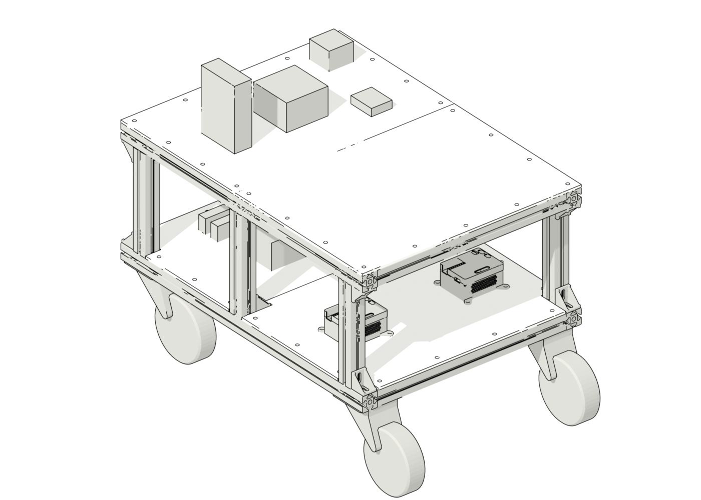
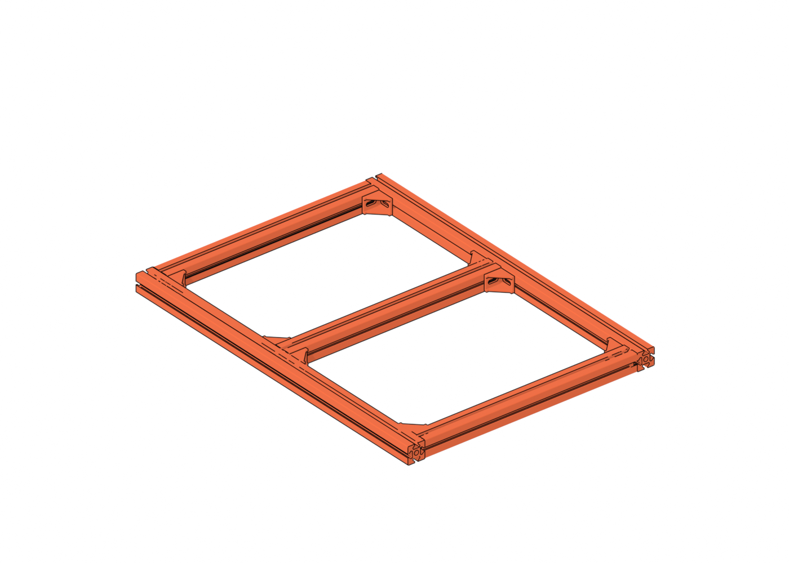
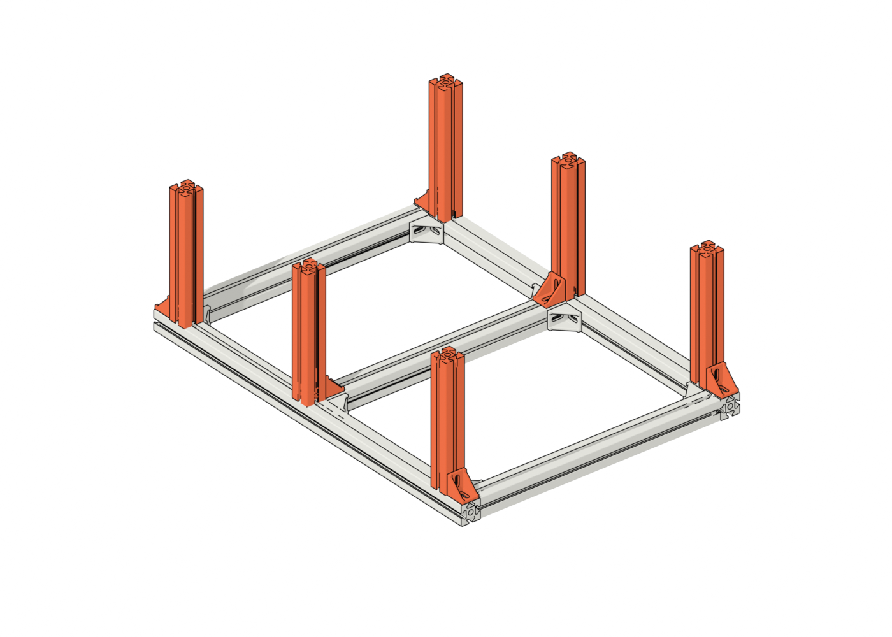
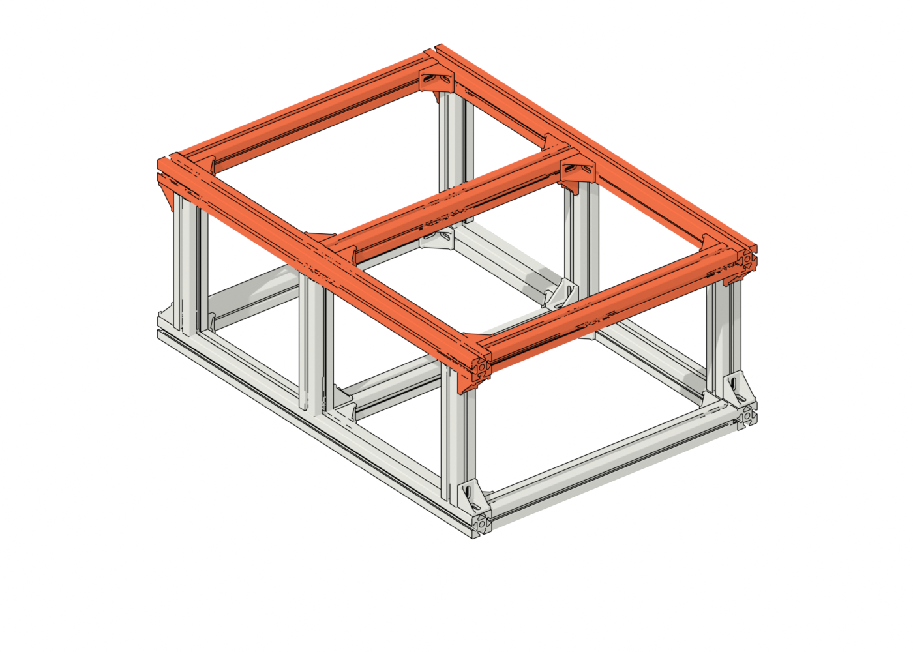
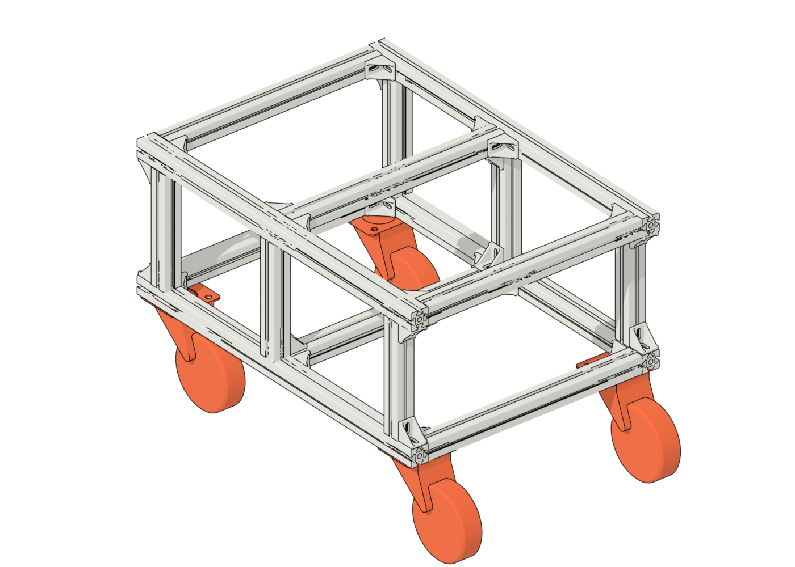
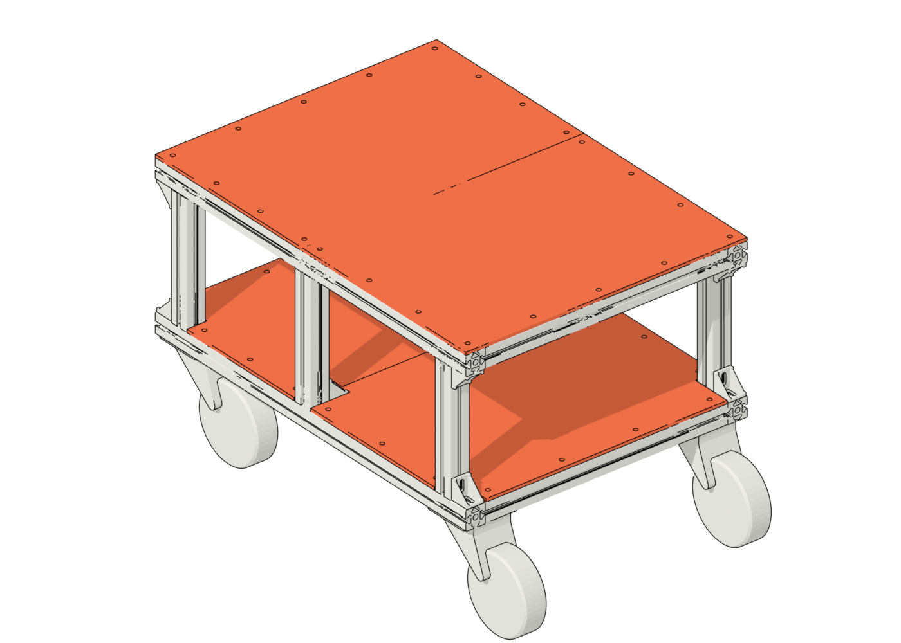
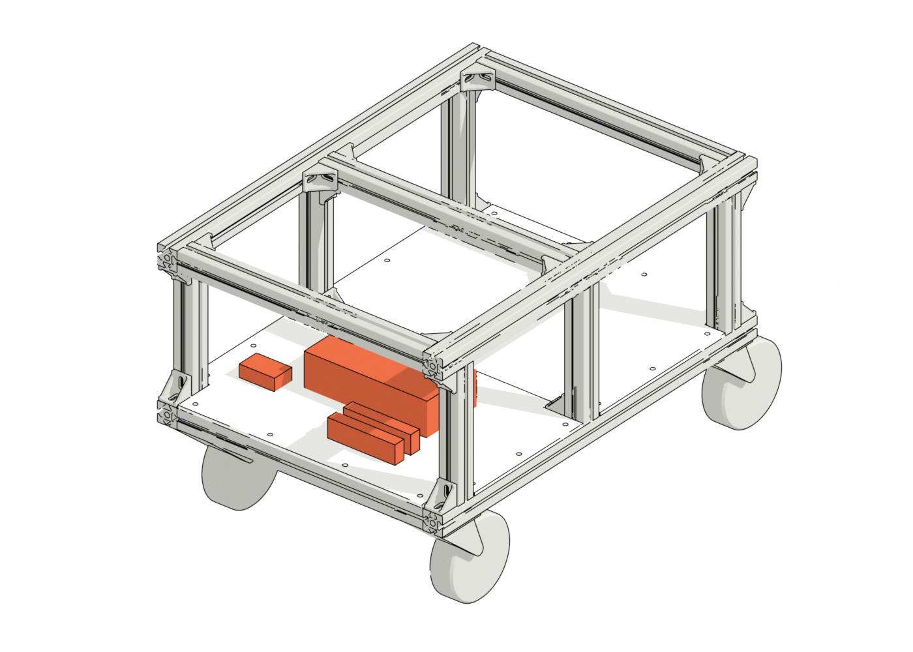
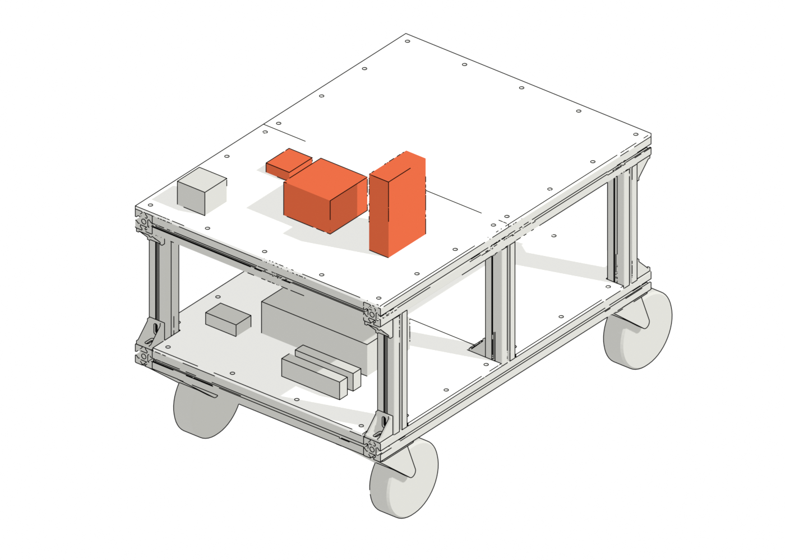
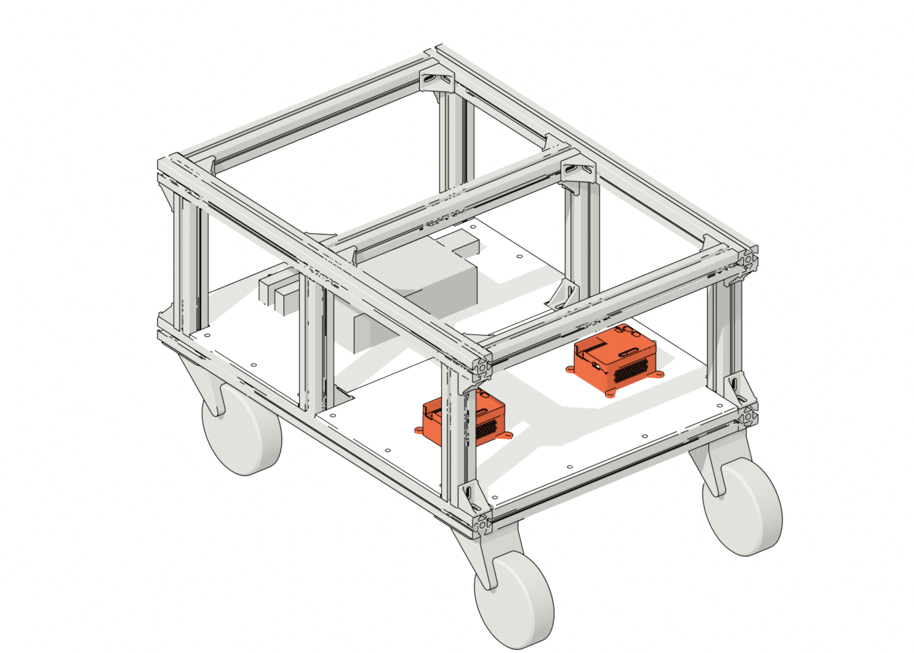

# Flatbot

An open reference design for a low-cost robot base for assistive robotics research. It's a two-deck frame of 4040 T-slot aluminum extrusion with laser-cut deck plates, sized to roughly a Permobil F5 power wheelchair footprint (800 × 580 mm). The bottom deck carries the battery and power distribution. The top deck carries the computer, network switch and drive controller, with room for a Kinova arm.



## Build options

- **Caster cart**: four 6 in swivel casters and no drive. Build this first so you can roll the frame around while the drive parts arrive.
- **Powered**: two front casters, plus ZLTech hub motors on the rear wheels driven by PACE RACER modules. A Waveshare ESP32-P4 runs the trajectory planner and sends the wheel commands.

## Parts

- **[BOM spreadsheet](https://docs.google.com/spreadsheets/d/1XnUZz30XRLGFOmL--75jbTeA3A-DteT97XAUyStrNJo/edit)** is the main reference. It has photos, buy links, quantities to order, prices and status, plus Assembly and Wiring tabs.
- [BOM.md](BOM.md) is the same parts list in text, with the reasoning behind each quantity.

About $4,200 for the priced parts as of October 2026. The Jetson AGX Orin accounts for $3,379 of that.

## Assembly

The Assembly tab of the spreadsheet lists the parts, fasteners and a check for each step. Parts added in a step are shown in orange.

| | |
|---|---|
|  **2. Bottom frame.** Two 800 mm rails and three 500 mm crossbars, 8 corner brackets. |  **3. Posts.** Six 250 mm posts, one bracket at each foot. |
|  **4. Top frame.** Same layout as the bottom, plus a bracket at the top of each post. |  **5. Casters.** One under each corner, bolted into the rail and crossbar T-slots. |
|  **6. Decks.** Four laser-cut plates, bolted to T-nuts. |  **7. Power.** Battery, bus bars and buck converters on the bottom deck (top deck hidden). |
|  **8. Compute and network.** Jetson, PoE switch, ESP32 and disconnect switch on the top deck. |  **9. Drive.** PACE RACER modules on the bottom deck (powered build). |

Step 1 is prep: check the parts and laser cut the deck plates.

## CAD

The model is in Onshape: [Flatbot Mechanical Assembly](https://cad.onshape.com/documents/44572ee178535fdca6908764/w/cc6b75fe056038bfa83c4cea/e/97ae17cb947b54ad84147e9e) (`cleanup` branch).

| Element | What it is |
|---|---|
| Flatbot Mechanical Assembly | The whole robot. |
| Decks | The laser-cut plates, made by the **Flatbot deck** feature. Change its parameters (frame length and width, post length, sheet thickness, hole size and spacing, split for a smaller laser bed) and the plates update. Export each plate as a DXF to cut it. |
| Components (stand-ins) | Box placeholders for the bought parts, made by the **Flatbot stand-in** feature. Each box carries the part name, vendor and ASIN so it shows up in the Onshape BOM. Swap them for vendor CAD when you have it. |
| Flatsheets and Motor Mounts | Hub motor mounts, still in progress. |

The FeatureScript sources are in [`featurescript/`](featurescript/).

Coordinates used throughout: X across the robot (centred), Y from the frame's front face toward the back, Z up from the top of the bottom frame. All dimensions are in mm.

## Repository layout

```
BOM.md                  parts list with quantities and reasoning
featurescript/          Onshape FeatureScript for the deck plates and component stand-ins
renders/                images of the assembly; renders/steps/ has one per assembly step
tools/                  Onshape API scripts used to build and edit the model
tools/render/           STEP -> STL -> Blender pipeline for the step images
```

### Onshape API scripts

`tools/onshape.py` is a small REST client. Put your keys in a `.env` file at the repo root (git-ignored):

```
ONSHAPE_ACCESS_KEY=...
ONSHAPE_SECRET_KEY=...
```

It caches GET responses in `cache/` and logs every real request to `cache/calls.log`, because Onshape accounts have an API call limit. The other scripts are one-off edits that built the current model (frame mates, stand-ins, casters). Read them before rerunning; they assume the document IDs in `onshape.py`.

### Re-rendering the step images

1. In Onshape, export the assembly as STEP with one file per part, and unzip it.
2. Convert to STL (needs FreeCAD):
   ```
   STEP_DIR=<unzipped folder> OUT_DIR=/tmp/flatbot_mesh \
     /Applications/FreeCAD.app/Contents/Resources/bin/freecadcmd tools/render/step_to_stl.py
   ```
3. Get each part's position from the assembly (one API call): `python3 tools/render/placements.py --fresh`
4. Render (needs Blender):
   ```
   /Applications/Blender.app/Contents/MacOS/Blender -b -P tools/render/render_steps.py -- /tmp/flatbot_mesh renders/steps
   ```

Which part belongs to which step is set by `step_of()` in `render_steps.py`.

## Open items

- Choose the computer: Jetson AGX Orin dev kit, or the Seeed reComputer Robotics J5012 the RAMMP prototype uses.
- Finish the hub motor mounts.
- Add prices for the non-Amazon parts and generic hardware.
